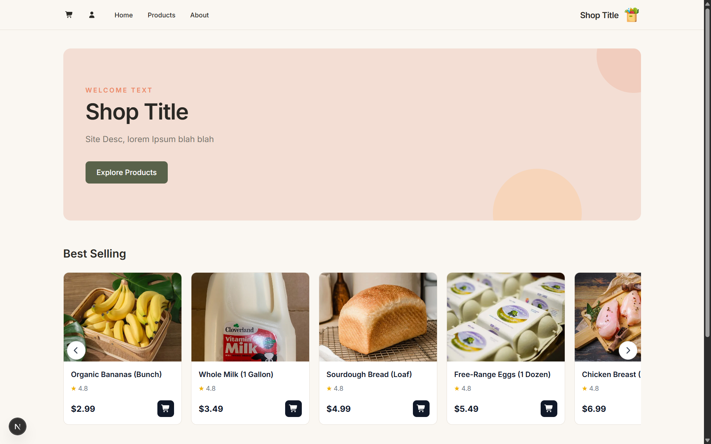
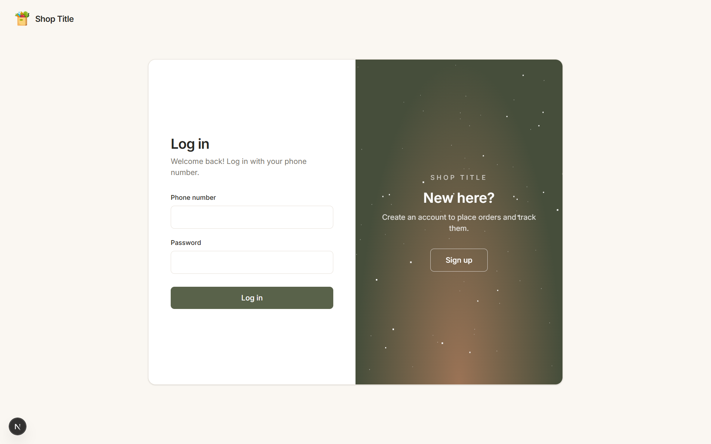
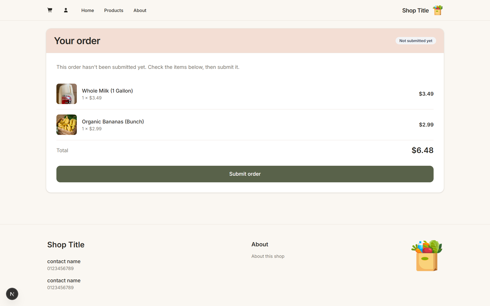
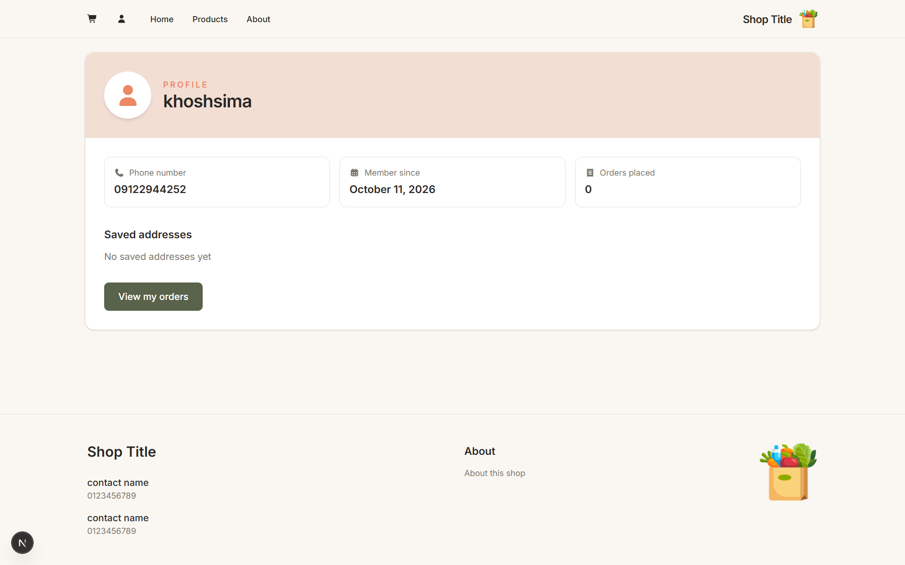
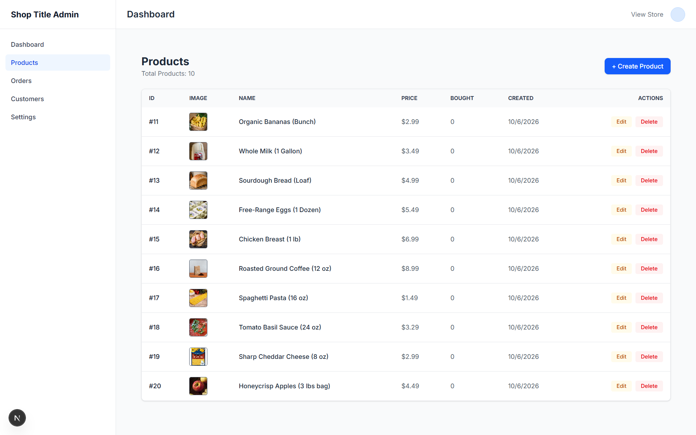

# Shop

A full-stack e-commerce application built with Next.js, allowing customers to browse products, manage their cart, and submit orders, with an admin dashboard for managing the shop.

## Overview

Shop is a web-based e-commerce application designed to explore essential online shopping workflows, from product browsing and order submission to administrative product and order management.

The application includes a customer-facing storefront and a separate admin dashboard. Administrators can manage products, configure shop settings, review orders, and track sales.

## Features

### Customer

- User registration and authentication
- Browse products and view product details
- Add and manage items in the shopping cart
- Submit orders
- Manage profile and delivery address
- View order history and status

### Admin

- Admin authentication
- Product management (CRUD)
- Shop settings management
- Order management
- View order details
- Track order totals and sales
- Update order status after customer confirmation

## Screenshots

### home

### login

### cart

### profile

### admin panel

## Tech Stack

### Frontend

- Next.js
- React
- TypeScript
- Tailwind CSS

### Backend

- Next.js App Router
- Next.js Route Handlers (API endpoints)

### Database

- PostgreSQL
- Prisma ORM

## Project Structure

The application separates the customer-facing storefront from the administrative dashboard, providing distinct workflows for customers and administrators.

## Status

Core functionality is complete.
